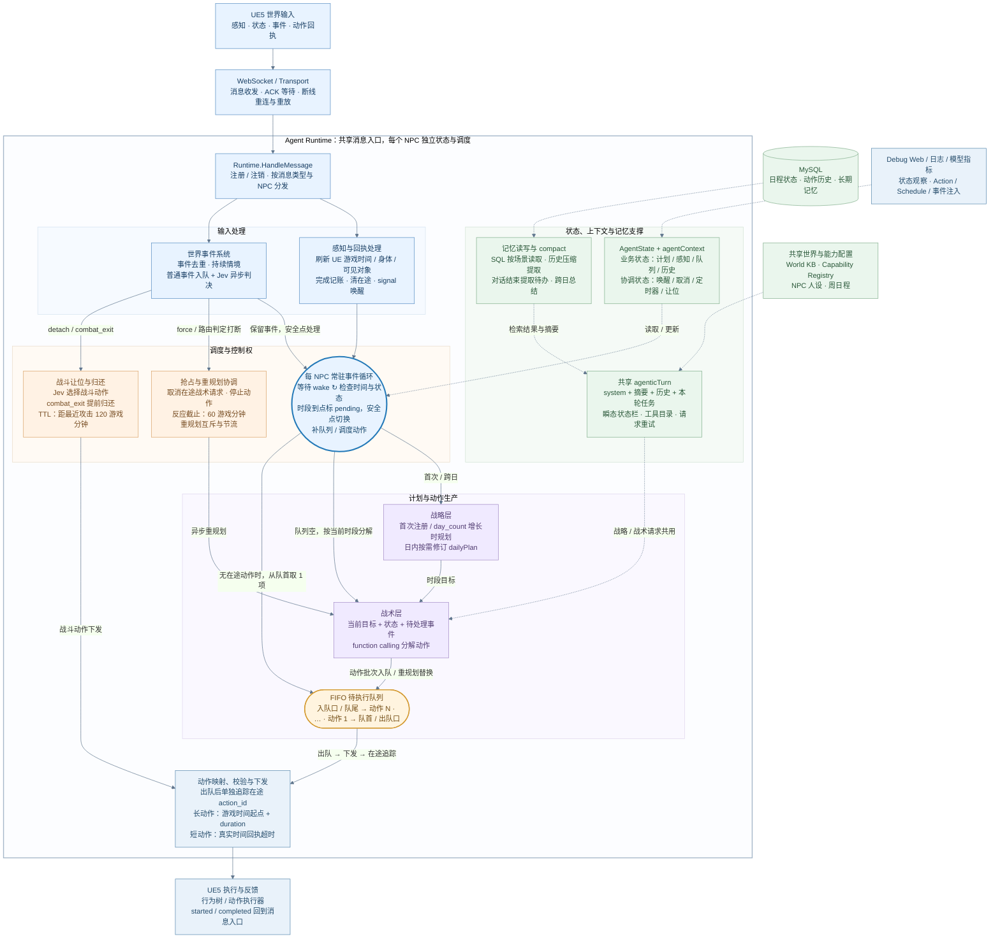
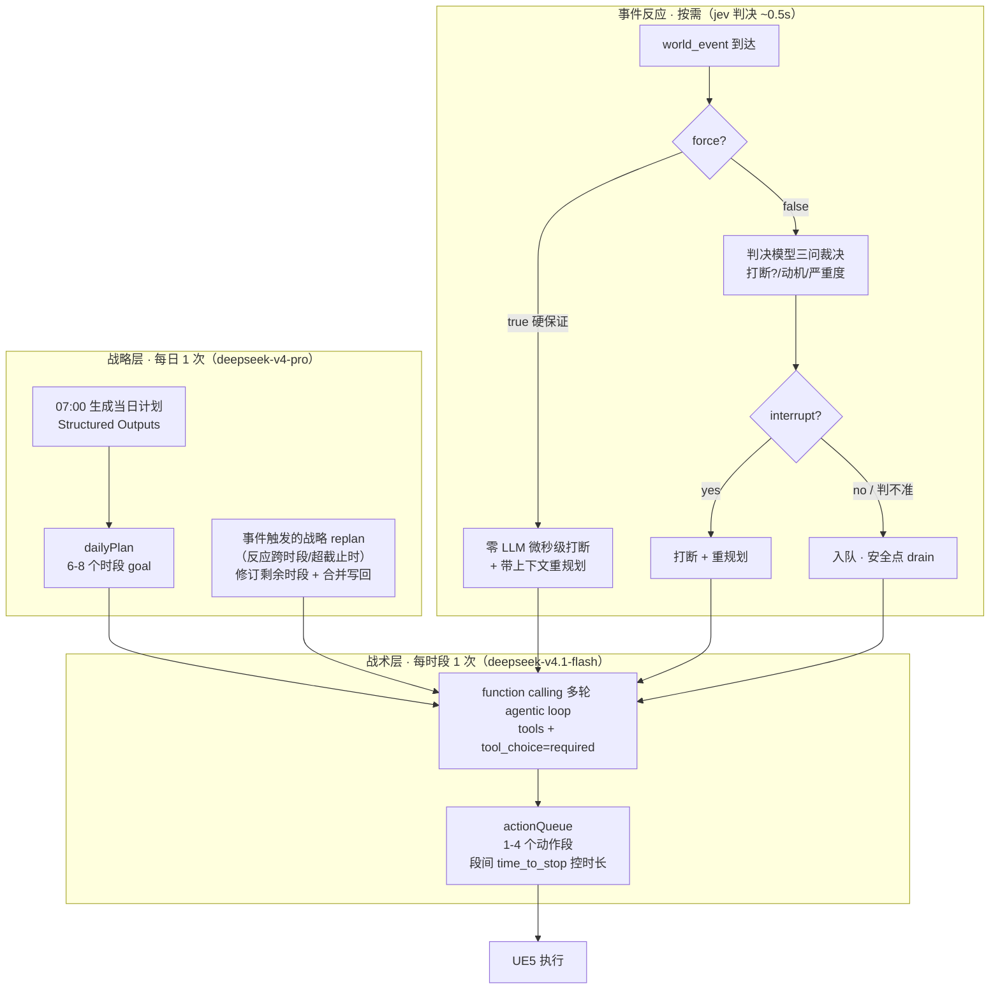
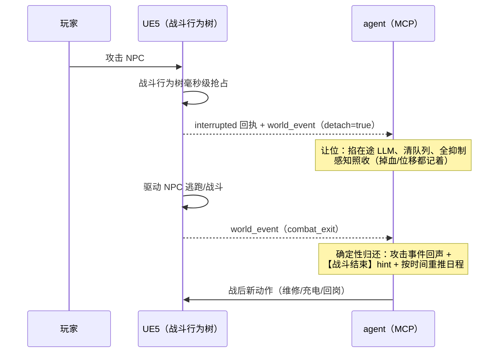

# AgentTown — LLM 驱动的 AI NPC 模拟系统

> **部署指引**：见 **[docs/Onboarding_Guide.md](docs/Onboarding_Guide.md)**

AgentTown 是一个让 AI NPC 在游戏世界里**长期自主生活**的模拟系统：在 UE5 构建的机器人小镇中，5 个拟人 NPC（H-01~H-05）各自拥有独立的性格人设与工种，白天上班装配、累了充电、闲时社交上网、被攻击了逃跑、受损了维修，约好的聚会也会真的赴约——所有行为由 LLM 实时决策，经 MCP 协议驱动真实 UE5 世界，形成完整的"感知 → 决策 → 行动 → 反应"闭环。

它不是脚本 NPC：

- **同一事件，不同反应**——"K-03 故障"广播推给所有 NPC，胆小的立刻丢下手里的活，沉着的入队继续工作。事件判决的输入包含每个 NPC 的性格、人际关系、当前动作与持续处境，反应分化是设计出来的涌现
- **日程自己规划**——每天 07:00 由 LLM 结合昨日记忆、今日星期属性（工作日/运动日/冥想日）和实时物理状态生成当天计划；被突发事件打断后还能修订剩余时段
- **会犯错也会自我纠正**——MCP 侧校验拒绝的非法动作指令（如缺目标的移动），拒绝原因回注会话历史，下一轮规划自行改正
- **有记忆、有关系、有亲疏**——上下文压缩时把即将逐出的经历沉淀为三张长期记忆表（过去经历 / 未来待办 / 对人认知），被攻击等关键事实规则直写（0 LLM）；对人认知收敛为单一好感度（0-100，50 中性）+ 一句印象，亲疏反过来影响事件裁决与行为决策
- **会约定也会守约**——对话中达成的约定当场抽取为结构化待办（绝对游戏日 + 时刻 + 地点），临近到期由代码触发战略层重排预留时间、战术层收到动身提示；受邀的消息还能作为「可分享的消息」在 NPC 间口口相传
- **被攻击真的会跑**——玩家攻击时 UE 战斗行为树接管 NPC 身体、agent 确定性让位（控制权毫秒级交接），脱战后 agent 带战后上下文（掉血/位移/战斗事件对）重新接管，自主决定先维修还是回岗

| 维度 | 数据 |
|------|------|
| NPC | 5 个（H-01~H-05），profile.md 人设按三层回退注入全部决策层 |
| 世界 | 7 区域 / 57 可交互设施（UE5 AgentTown 地图，world_kb 数据驱动） |
| 动作 | 12 种 cmd（7 原子 + 5 复合）+ 2 特殊工具，UE `capability_registry` 动态派生 |
| 决策延迟 | 强制事件微秒级（零 LLM 硬保证通道）；事件判决 ~0.5s；战术分解秒级 |
| 长期记忆 | 三表（episodic_memories 经历 / episodic_commitments 待办 / semantic_people 对人认知），compact 时沉淀，MySQL 持久化 |
| 仿真规模 | time_scale 90（1 现实秒 ≈ 90 游戏秒），多游戏日无人值守连续运行 |
| 技术栈 | Go 1.25（三 module）· UE5 C++/蓝图 · Venus LLM（OpenAI 兼容）· MySQL · WebSocket |

---

## 系统架构

### 总体架构



| 组件 | 语言 | 职责 |
|------|------|------|
| 真实 UE5 | C++/蓝图 | 游戏世界：物理/空间状态权威、动作执行、感知推送、世界事件上传、战斗行为树接管 |
| contract module | Go | 契约：7 字段信封协议 + `Transport` 接口（决策侧与连接侧边界，零依赖） |
| wsserver module | Go | 连接：WS 收发、seq 重放补偿、ACK 等待，实现 `contract.Transport` |
| 根 module | Go | agent 决策 + 装配壳 + `pkg/` 领域库（prompt / worldkb / storage / jev / …） |
| Venus / 自部署推理 | 远程/本地 | OpenAI 兼容 LLM 服务：战略（每日 1 次）、战术（每时段 1 次）、事件判决（按需） |
| MySQL | 本地 | 持久化（可选）：调度状态、长期记忆三表（经历/待办/对人认知）、动作历史 |

### 三 module 模块化设计

连接侧与 agent 决策侧物理拆分，**依赖倒置**——决策核心只依赖 `contract.Transport` 接口、不感知 WS 实现；入站消息经 `Runtime.HandleMessage` 单入口分发，运输层只注册两个回调。测试用 fake Transport 替身即可覆盖全部分发逻辑。

```
agenttown-mcp/                  # 根 module：agent 决策 + 装配壳 + 领域库
  cmd/agenttown-mcp/            # 入口 + Runtime 分发 + 三层决策 + 事件路由 + debug UI
  pkg/
    prompt/                     # 三层共享 system prompt + 各层 user prompt + 物理分档 + 事件渲染
    agentstate/                 # 每 NPC 业务状态：动作队列/会话历史/事件队列/持续情境/调度状态
    jev/                        # 事件判决模型客户端（state + 三型问题）
    venus/                      # LLM 客户端（function calling + Structured Outputs + 流式）
    llmconfig/                  # --llm-config 分层后端配置（战略/战术各自 URL+模型）
    llmmetrics/                 # LLM 指标聚合（E2E/TTFT/TPOT/ITL 分位数 + 错误分布）
    llmtokens/ llmtypes/        # token 计数 / 共享响应类型
    transport/                  # Streamable HTTP（MCP /mcp 端点）
    worldkb/                    # 世界 KB 加载/合并/校验/查询
    profile/                    # NPC 人设档案（assets/profiles/*.md）
    weeklyschedule/             # 每周日程配置（7 天周期）
    storage/                    # MySQL 持久化 + //go:embed 迁移（默认内存模式）
  adapters/agenttown/tools/     # MCP 工具（5 复合 + 7 原子 + 2 特殊，registry 动态增删）
  internal/log/                 # slog JSON 日志（环形缓冲 + 文件/stderr）
  contract/                     # 契约 module（无依赖）：protocol + Transport 接口
  wsserver/                     # 连接 module：WS 收发/seq 重放/ACK，实现 contract.Transport
```

依赖方向（单向、无环）：

```
contract（协议 + Transport 接口）← 无依赖
wsserver（连接实现）            ← 依赖 contract
根 module（agent 决策 + 壳）     ← 依赖 contract + wsserver
```

根 `go.mod` 通过 `replace => ./contract` / `=> ./wsserver` 引用本地 module；发布时把 replace 换成 tag 版本即可独立替换 agent 侧。

### 三层决策架构

不同时间尺度的决策匹配不同档次的模型——**成本结构是设计出来的**：贵的 pro 模型每天只花 1 次在"今天怎么过"上，时段分解用 flash 快模型，最频繁的事件裁决交给专用判决模型（~0.5s）。



| 层 | 频率 | 模型 | 输入 | 输出 |
|----|------|------|------|------|
| 战略层 | 每日 07:00 一次 + 事件触发 replan | deepseek-v4-pro | 共享 system prompt + 物理/昨日总结/星期属性/其他 NPC/今日待办 | dailyPlan（6-8 时段 JSON，Structured Outputs） |
| 战术层 | 每时段 1 次，队列耗尽时 refill | deepseek-v4.1-flash | 共享 system prompt + 时段目标/实时状态/事件队列/记忆/待办/人际关系 | tool_calls（1-4 动作段 + time_to_stop） |
| 事件判决 | 每条非 force 事件 | jev-1.13.0（Venus 判决 API） | 结构化 state（人设/关系/近期行为/当前动作/持续处境） | 三问：是否打断/动机/严重度 |
| 记忆压缩 | 上下文超 10k token 或日切强制 | deepseek-v4.1-flash（复用战术层客户端） | 滚动摘要 + 待逐出历史 | 摘要 + 经历 episodes + 好感度/印象更新 |
| 对话待办抽取 | 每次定向对话结束 | deepseek-v4-pro | 人设 + 对话 transcript + 当前游戏时间 | 未来待办（游戏日 + HH:MM）+ 核销/改期 |

### 事件驱动反应体系

反应不走轮询、不走大模型闲聊，而是**边沿触发的事件通道 + 确定性优先**：

- **事件 ≠ 心跳**：位置/电量等连续量走 `perception_update` 只刷状态；只有"有发生那一刻的事"（能量跨阈值、进出 zone、被攻击、设备故障）才走 `world_event`，且边沿触发、去抖防风暴
- **force 硬保证通道**：UE 打标的强制事件（被攻击/剧情指令）零 LLM、零去抖、不可否决，微秒级打断在 WS 接收路径同步完成
- **判决路由**：非 force 事件由判决模型裁决（~0.5s），输入含 NPC 性格/关系/当前动作/持续处境——同一事件不同 NPC 产生分化反应；判不准一律保守入队，事件零丢失
- **安全点 drain**：入队事件在当前动作完成后一次性注入战术层 prompt（第三输入），快照注入 + 成功后清空，LLM 失败事件不丢
- **反应护栏**：打断产生的"反应任务"有 60 游戏分钟截止硬切 + severity 严格递增（低级别事件不能打断高级别反应），防连环打断与无限反应
- **持续威胁情境 + 事件回声**：威胁在解除信号到达前持续注入每轮 prompt，防"反应做完就自称威胁解除"的幻觉；被打断后的第一次重规划能再见到原始事件
- **在途 LLM 可取消**：强制事件能掐掉飞行中的战术层请求（ctx 贯穿 HTTP），半截思考零残留

### combat-detach 战斗接管

玩家攻击 NPC 时 UE 战斗行为树接管身体，这是一套**确定性控制权交接协议**（全程不过模型）：



每个方向都有兜底：UE 忘发 `combat_exit` → 120 游戏分钟 TTL 租约自动收回；UE 接管未生效 → 2s 宽限期后代为停动作（宽限期内不 stop，避免杀掉刚启动的接管）；断线重连让位状态存续；重复攻击幂等。2026-09-22 联调跑通：UE 抢占与打断回执同毫秒完成，宽限期保险丝零触发。

### 长期记忆与社交对话

**三表记忆模型**（设计文档 `docs/AgentTown_LongTermMemory_SQLite_Design.md`，MySQL 持久化，`owner_id` 第一分区键实现信息隔离——A 的记忆 B 绝对查不到，信息只能靠说话传播）：

| 表 | 内容 |
|----|------|
| `episodic_memories` | 过去经历：game_time 锚定的第一人称一句话摘要 + 参与者 + 重要性/情绪 |
| `episodic_commitments` | 未来待办：约定（appointment）/ 传话（relay）/ 活动邀请（invitation）/ 自办事项（todo），状态机 pending → done / expired / cancelled |
| `semantic_people` | 对人认知：单一好感度（0-100，50 中性）+ 一句印象（住址/喜好等零散事实并入印象，不拆多维） |

读写各有纪律：

- **写只在 compact**：平时发生的事就住在会话上下文里（NPC 天然"记得"），只有上下文压缩、内容即将被逐出时才抽成结构化记忆落盘——不重复写。跨日清空历史前强制 compact 一次，兜住低活动日的经历丢失；被攻击等关键事实**规则直写**（0 LLM：combat episode + 攻击者好感度 -50）
- **读零 LLM**：`memoryReader` 内部工具纯程序查询（索引 + LIKE + 内存打分），不注册进 function calling、LLM 不可见；三层决策按需取用——战略层排日程看未来 24h 待办 + 昨日总结，战术层看眼前人的好感/印象、临近 1h 的约定与【可分享的消息】
- **待办闭环**：对话结束当场抽取约定，时间用「绝对游戏日 + HH:MM」让 LLM 抄写、代码换算秒数（实测让 LLM 算累计秒会输出墙钟秒等垃圾值）；临近到期（≤12 游戏小时）由代码触发战略层重排预留时段；过期在读时 SQL 动态过滤，不回写
- **口口相传**：受邀类待办进入【可分享的消息】，战术层被要求与人聊天时主动告知——消息不靠系统广播，靠 NPC 一张嘴一张嘴传开

**对话收尾与守约**：定向对话（`speak_to`）一律单动作；LLM 判断本句是收尾时标 `ends_conversation`，话语送达即释放等待（不等满 ~10s no_reply 窗）；对话终局即时关会话并注入守约 hint——完整对话记录 + "约定了就立即去执行，守约优先于当前时段目标"；轮次上限 6 + 会话续接窗口（60s 内同对象再开口自动接上旧轮次）防 ping-pong 与失忆重开。

### 关键机制速览

| 机制 | 要点 |
|------|------|
| 7 字段信封 | 所有消息共用外层（version/msg_id/seq/timestamp/type/agent_id/payload），业务字段一律入 payload |
| seq 重放补偿 | 双方发送缓冲（200 条/60s），断线重连交换 resync 重放离散消息，连续状态以最新快照为准 |
| 动作异步生命周期 | action_command → action_started（ACK ≤2s）→ action_completed（result/duration），超时重决策 |
| 智能设施排队 | 目标被占用时自动排队（auto_queue），queued/advanced/timeout 状态推送，超时回退重决策 |
| world_kb 自动适配 | UE 推送新 KB → 重启即全链路适配（prompt/工具 schema/兜底日程全从 KB 派生），换地图零代码 |
| NPC 人设注入 | profile.md（名字/职业/背景/性格/说话风格/属性分段）三层回退（profile > KB > 内置），贯穿所有决策层 |
| 长期记忆 | 三表模型（经历/待办/对人认知）；写只在 compact（日切强制兜底）+ 攻击规则直写；读走 memoryReader 内部工具，零 LLM |
| 对话与守约 | speak_to 单动作 + ends_conversation 送达即释放；对话终局即时注入守约 hint（守约优先于时段目标）；轮次上限 6 防对话 ping-pong |
| 关系与好感度 | semantic_people 单表：好感度 0-100 + 一句印象，compact 时 people_updates 更新（夹紧 0-100）→ 注入路由/战术/战略【人际关系】段（好感 x/100） |
| LLM 可靠性兜底 | 坏 tools JSON 同请求重试（实测 100% 救回）、time_to_stop 兜底、失败兜底动作防呆站 |
| 全链路可观测 | 统一 JSONL 日志（UE/MCP/LLM 三层）、decision_epoch 串联决策轮次、LLM 分位数指标 |

---

## 通信协议

- **传输**：WebSocket（UE5 → MCP `ws://<host>:9092/ws`），7 字段信封，时间戳毫秒、坐标厘米（UE5 单位）
- **消息类型**（15 种）：`world_kb` / `agent_registered` / `capability_registry`（UE 连接首发三连）→ `perception_update` / `state_report`（感知）→ `action_command` / `action_started` / `action_completed` / `action_queued` / `stop_action`（动作生命周期）→ `world_event`（事件通道，含 `speech_heard` 定向话语）→ `heartbeat` / `error` / `resync` / `event_lost`（系统级）
- **12 种 cmd**：原子 `GenericAct` / `MoveTo` / `Wait` / `TurnTo` / `Speak` / `InteractSmartObject` / `Emote`；复合 `WorkShift` / `ChargeAtStation` / `SelfMaintenance` / `RestAtResidence` / `SurfInternet`。语义目标（`semantic_group`）由 UE 解析，MCP 不做坐标换算

完整协议（字段表/数值系统/时序图）见 `docs/AgentTown_CommProtocol_Values.md`；事件通道见 `docs/AgentTown_WorldEvent_Protocol.md`。

---

## 目录结构

```
agenttown-mcp/                  # Go 三 module 仓库主体（见"三 module 设计"）
assets/
  world_kb.yaml                 # 世界 KB：7 zones / 57 objects / 5 agents
  world.generated.json / world.authored.json   # UE 推送的世界数据（merge 输入）
  llm_backend.example.yaml      # 自部署 LLM 后端分层配置模板（复制为 llm_backend.yaml 使用，后者已 gitignore）
  profiles/H-01.md ~ H-05.md    # NPC 人设档案
  weekly_schedule.yaml          # 每周日程（工作日/休息日/运动日/冥想日）
docs/                           # 设计文档（协议/事件/架构/KB/记忆，见下方索引）
scripts/
  pretty_log.py                 # 日志可读化（HTML 报告 + 终端渲染）
  smoke_combat_detach.py        # combat-detach 无 UE 冒烟
  test_world_kb_e2e.py          # world_kb 推送 E2E
  test_phase7_reconnect.py      # 断线重连 + seq 重放验证
  bench_venus_latency.py / venus_latency_test.py / eval_venus_models.py   # LLM 压测/延迟/评估
  analyze_time.py               # 游戏时间流速分析（time_scale 校验）
  push_world_kb.py / setup-cloud-env.sh
start-debug.sh                  # stable 启动（MySQL + 编译 + MCP + 健康检查）
start-dev.sh                    # dev 启动 wrapper（偏移端口/库名/日志目录）
start-vllm-tunnel.sh            # Windows→AutoDL SSH 正向隧道（自部署 vLLM 用）
.env.example                    # 环境变量模板（分组注释）
CLAUDE.md                       # 工程手册（架构/机制/命令/文件地图，最全）
```

## 文档索引

| 文档 | 内容 |
|------|------|
| `CLAUDE.md` | 工程手册：架构总览、全部关键机制、命令、flag、文件地图 |
| `docs/Onboarding_Guide.md` | 新人上手/部署指南：容器访问、双实例启动、联调排查（新同事从这里开始） |
| `docs/AgentTown_Architecture_Highlights.md` | 项目架构与技术亮点总览（评审/onboarding 入口） |
| `docs/AgentTown_CommProtocol_Values.md` | 通信协议与数值系统（唯一权威） |
| `docs/AgentTown_WorldEvent_Protocol.md` | UE → Agent 事件上传协议（含 combat-detach） |
| `docs/AgentTown_EventDrivenAgent_Design.html` | 事件驱动异步 Agent 设计 |
| `docs/AgentTown_EventDriven_Implementation_Plan.md` | 事件驱动实施计划（P0-P5） |
| `docs/AgentTown_Core_DeepDive.md` | 核心机制深潜 |
| `docs/AgentTown_WorldKB_Design.md` | 世界 KB 设计 |
| `docs/AgentTown_LongTermMemory_SQLite_Design.md` | 长期记忆三表设计（写只在 compact / 读零 LLM / 待办闭环） |
| `docs/DebugAction_Tool.md` | Debug 工具使用文档 |
| `docs/llm_metrics.md` | LLM 指标报告（运行时自动生成） |
