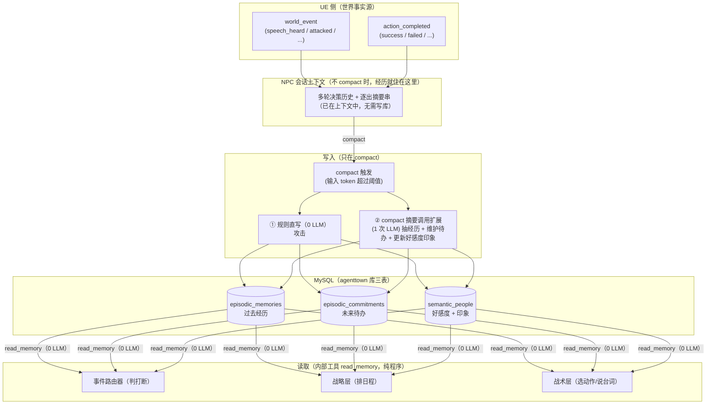

# AgentTown NPC 长期记忆系统设计方案（MySQL 版）

> **定位**：每个 NPC 一个独立的长期记忆库。记忆不是「每发生一件事就写一次」，而是**上下文压缩（compact）时的沉淀**——平时发生过的事就住在 NPC 的会话上下文里，NPC 天然「记得」；只有当上下文太长需要压缩、某些内容即将被逐出时，才把它们抽成结构化记忆落盘，供之后（上下文里已经没有这些内容时）回顾。
>
> **核心原则**：
> 1. **写只在 compact**：记忆写入仅发生在上下文压缩时；不 compact 不写库（此时内容仍在上下文中，写库是重复）。
> 2. **读零 LLM**：读记忆全程纯程序（MySQL 索引 + LIKE 关键词 + 内存打分），包装成一个内部工具 `read_memory`，**暂不开放给 LLM 调用**，由程序在需要时调用并把结果拼进对应层 prompt。
> 3. **对人认知只用一个好感度值**：不拆熟悉度/信任度等多维度，一个 0–100 的好感度 + 一句话印象即可。
> 4. **时间统一**：一切时间戳用 UE 游戏时间秒（`game_time_sec`），不依赖现实时钟。
> 5. **信息隔离**：所有表以 `owner_id` 为第一分区键；A 的记忆 B 绝对查不到，信息只能通过说话（`speech_heard`）或旁听传播。
> 6. **存储**：MySQL（复用现有持久化层 `pkg/storage`，`owner_id` 分区；原 SQLite 方案改 MySQL——FTS5 trigram 无对应，联想召回降级为 `LIKE`）。

---

## 1. 全景架构图



---

## 2. 存什么？（三张表）

### 2.1 情景记忆 · 过去经历 `episodic_memories`
已经发生过的具体事件，只追加。第一人称一句话摘要，直接进 prompt。
- **例 1（对话经历）**：`D3 15:00 在咖啡馆和老王聊下棋，约好明天下午两点在公园棋桌下一盘。`
- **例 2（战斗受袭）**：`D3 17:00 在废品站被 player_01 开枪袭击，机身受损严重后逃离。`
- **例 3（日常活动）**：`D3 20:10 晚上去网吧上网，机器全被占满，改去公园散步。`

### 2.2 情景记忆 · 未来待办 `episodic_commitments`
前瞻性子表，目标只有一个——**让 NPC 知道未来某时某地有这件事要做**。状态机极简（`pending → done / expired / cancelled`）。
- **例 1（约时间地点 `appointment`）**：`D4 14:00~15:00 在公园棋桌和老王下棋`（`counterpart_id = npc_wang`）。
- **例 2（替人传话 `relay`）**：`遇到小李时转告他：老王让他明天去拿扳手`（`counterpart_id = npc_li`）。
- **例 3（活动邀请 `invitation`）**：`D4 18:00~22:00 中央广场老王的生日聚会`。

### 2.3 语义记忆 · 对人认知 `semantic_people`
从互动中沉淀下来的、对其他人的稳定认知。**唯一数值维度是好感度（0–100，50 为中性）**，外加一句自由文本印象。不再拆熟悉度/信任度，也不单建「事实三元组」表——关于人的零散事实（住址、喜好、健康状况）直接并入印象一句话。
- **例 A（老邻居）**：对 `npc_wang` → `好感度 65`；印象 `"爱下棋的老邻居，说话算话，最近搬到了B区3号楼，腰不太好。"`
- **例 B（袭击过自己的玩家）**：对 `player_01` → `好感度 10`；印象 `"危险的袭击者，昨天在废品站无故开枪打伤了我。"`

> **被刻意简化的部分**：原设计中的 `semantic_facts`（subject/predicate/object 三元组 + supersede 链）、`semantic_self`（scope/evidence 多表）、`procedural_memories`（触发条件 + 策略 + evidence ≥2 + 置信度 + 采纳/成败计数）一律删除——它们过于复杂，收益不抵维护成本。自我认知与经验教训由日终 compact 时生成的一条 `category='daily_summary'` 情景摘要承载（复用现有 `generateDailyMemories` 的昨日总结通道），不单建表。

---

## 3. 怎么存？（MySQL 表结构与样例）

复用现有 MySQL 持久化层（`pkg/storage`，`--mysql-dsn`）。实际 DDL 见迁移
`agenttown-mcp/pkg/storage/migrations/0005_memory_architecture.sql`。下方 DDL
为概念示意：SQLite 的 `TEXT PRIMARY KEY` 在 MySQL 用 `VARCHAR(64)`、`REAL`
用 `DOUBLE`、`INTEGER` 用 `BIGINT`、`participants_json` 用 JSON 列。

### 3.1 表 1：`episodic_memories`（过去经历）
```sql
CREATE TABLE IF NOT EXISTS episodic_memories (
    id                TEXT PRIMARY KEY,               -- 如 "ep_20261019_0001"
    owner_id          TEXT NOT NULL,                  -- 记忆所属 NPC（如 "H-01"）
    game_time         INTEGER NOT NULL,               -- 发生时的游戏时间秒
    game_day          INTEGER NOT NULL,               -- 第几个游戏日
    location          TEXT NOT NULL DEFAULT '',       -- zone_id 或 object_id
    category          TEXT NOT NULL,                  -- conversation / combat / daily_summary
    summary           TEXT NOT NULL,                  -- 第一人称一句话摘要（直接进 prompt）
    participants_json TEXT NOT NULL DEFAULT '[]',     -- 涉及 agent_id 数组，如 '["npc_wang"]'
    importance        INTEGER NOT NULL DEFAULT 5,     -- 1 ~ 10
    emotion           REAL NOT NULL DEFAULT 0.0,      -- -1.0 ~ +1.0
    source            TEXT NOT NULL DEFAULT 'self',   -- self / heard / overheard
    status            TEXT NOT NULL DEFAULT 'active'  -- active / archived
);

CREATE INDEX IF NOT EXISTS idx_ep_owner_time ON episodic_memories(owner_id, status, game_time DESC);
CREATE INDEX IF NOT EXISTS idx_ep_owner_day  ON episodic_memories(owner_id, game_day);
```

**样例数据**：
| id | owner_id | game_time | category | summary | participants_json | importance | source |
|---|---|---|---|---|---|---|---|
| `ep_001` | `H-01` | 226800 (D3 15:00) | `conversation` | 在咖啡馆和老王聊下棋，约好明天下午两点在公园棋桌下一盘，还答应帮他给小李带句话。 | `["npc_wang"]` | 7 | `self` |
| `ep_002` | `H-01` | 234000 (D3 17:00) | `combat` | 在废品站被 player_01 开枪袭击，机身受损严重后逃离。 | `["player_01"]` | 9 | `self` |
| `ep_003` | `H-01` | 244800 (D3 20:00) | `conversation` | 晚上去网吧上网，机器全被占满，改去公园散步。 | `[]` | 4 | `self` |

---

### 3.2 表 2：`episodic_commitments`（未来待办）
```sql
CREATE TABLE IF NOT EXISTS episodic_commitments (
    id               TEXT PRIMARY KEY,                -- 如 "cm_20261019_0001"
    owner_id         TEXT NOT NULL,
    origin_ep_id     TEXT NOT NULL DEFAULT '',        -- 产生该待办的 episodic_memories.id
    kind             TEXT NOT NULL,                   -- appointment / relay / invitation / todo
    counterpart_id   TEXT NOT NULL DEFAULT '',        -- 关联对象（约老王填 npc_wang）
    counterpart_name TEXT NOT NULL DEFAULT '',
    content          TEXT NOT NULL,                   -- 具体待办内容（直接进 prompt）
    due_start        INTEGER NOT NULL DEFAULT 0,      -- 开始游戏秒
    due_end          INTEGER NOT NULL DEFAULT 0,      -- 截止游戏秒
    due_location     TEXT NOT NULL DEFAULT '',
    status           TEXT NOT NULL DEFAULT 'pending', -- pending / done / expired / cancelled
    created_time     INTEGER NOT NULL,
    updated_time     INTEGER NOT NULL DEFAULT 0
);

CREATE INDEX IF NOT EXISTS idx_cm_owner_due         ON episodic_commitments(owner_id, status, due_start, due_end);
CREATE INDEX IF NOT EXISTS idx_cm_owner_counterpart ON episodic_commitments(owner_id, status, counterpart_id);
```

**样例数据**：
| id | owner_id | kind | counterpart_id | content | due_start | due_end | due_location | status |
|---|---|---|---|---|---|---|---|---|
| `cm_01` | `H-01` | `appointment` | `npc_wang` | 在公园棋桌和老王下棋 | 309600 (D4 14:00) | 313200 (D4 15:00) | `zone_park` | `pending` |
| `cm_02` | `H-01` | `relay` | `npc_li` | 转告小李：老王让他明天去拿扳手 | 226800 | 345600 | `""` | `pending` |
| `cm_03` | `H-01` | `invitation` | `npc_wang` | 老王在中央广场办生日聚会 | 324000 (D4 18:00) | 338400 (D4 22:00) | `zone_central_plaza` | `pending` |

---

### 3.3 表 3：`semantic_people`（对人认知）
```sql
CREATE TABLE IF NOT EXISTS semantic_people (
    owner_id           TEXT NOT NULL,                 -- 记忆所属 NPC
    target_id          TEXT NOT NULL,                 -- 对方 ID（npc_wang / player_01）
    target_name        TEXT NOT NULL DEFAULT '',      -- 对方名字（如 "老王"）
    affinity           INTEGER NOT NULL DEFAULT 50,   -- 好感度 0 ~ 100（唯一数值维度，50 中性）
    impression         TEXT NOT NULL DEFAULT '',      -- 一句话印象（自由文本备注，含住址/喜好等零散事实）
    last_interact_time INTEGER NOT NULL DEFAULT 0,    -- 最近一次互动的游戏秒
    PRIMARY KEY (owner_id, target_id)
);
```

**样例数据**：
| owner_id | target_id | target_name | affinity | impression |
|---|---|---|---|---|
| `H-01` | `npc_wang` | 老王 | 65 | 爱下棋的老邻居，说话算话，最近搬到了B区3号楼，腰不太好。 |
| `H-01` | `player_01` | 陌生人类 | 10 | 危险人物，在废品站无故攻击过我，见到要远离。 |

---

### 3.4 联想召回（MySQL 无 FTS5，降级 LIKE）

SQLite 的 `fts5` trigram 全文检索在 MySQL 无对应（MySQL FULLTEXT 需 ngram
解析器且匹配语义不同）。数据量小，联想召回直接对 `summary` 做 `LIKE '%kw%'`
关键词匹配（`LoadEpisodes` 的 `Keywords` 过滤），不建 FULLTEXT 索引。

---

## 4. 什么时候写？——只在 compact 时

记忆不是「每发生一件事就写一次」，而是**上下文太长、需要压缩时才沉淀**。这与现有 `compaction.go` 的压缩机制完全对齐：

- **不 compact 不写**：一段对话、一次攻击、一个约定刚发生时，它们就在 NPC 的会话上下文（多轮决策历史）里，NPC 已经「记得」，无需落盘。
- **compact 时一次性沉淀**：当该 NPC 的战术层输入 token 超过阈值（`compactTriggerTokens`，现 10000）触发 `maybeCompactConversation` 时，把即将被逐出的历史抽成结构化记忆写入 MySQL（三张新表）。写完之后，上下文里即使没有了这些内容，记忆库仍能让 NPC 回想起来。

在 compact 的落点上做两件事：

### 4.1 规则直写（0 LLM）
从被逐出的内容里能确定性提取的，直接用代码写库，不调 LLM：

| 内容 | 写哪张表 | 操作 |
|---|---|---|
| 被攻击（`player_attacked` / `attacked`） | `episodic_memories` + `semantic_people` | 插一条 `category='combat', importance=9, emotion=-0.9` 的情景；对 attacker `UPSERT semantic_people`：`affinity = MAX(0, affinity - 50)` |

> 动作失败**不再单独写 memory episode**——`action_history` 已完整落盘可审计，且失败多为 UE 侧 bug（no_smartobject_in_zone / too_tired），记忆价值有限。

### 4.2 compact 摘要调用扩展（1 次 LLM）
compact 本就调用一次摘要 LLM（`summarizeConversation` → `compactSystemPrompt`「记忆压缩模块」）。把这次调用的输出从「纯文本摘要串」扩展为「摘要串 + 结构化记忆 JSON」，一次调用同时产出：

1. **抽经历**：把逐出的历史总结成 1~3 条 `episodic_memories`；
2. **维护待办**：提取新建的约定、改期或取消（`episodic_commitments` 的 insert/update）；
3. **更新好感度与印象**：对互动涉及的对方给出好感度增量与新的 `impression`。

**扩展输出 JSON 示例（H-01 与老王对话被 compact 时）**：
```json
{
  "episodes": [
    {"summary": "在咖啡馆和老王聊下棋，约好明天（D4）14:00在公园棋桌下棋，并答应帮他转告小李明天去拿扳手。", "importance": 7, "emotion": 0.6, "participants": ["npc_wang"]}
  ],
  "new_commitments": [
    {"kind": "appointment", "counterpart_id": "npc_wang", "content": "在公园棋桌和老王下棋", "due_start": 309600, "due_end": 313200, "due_location": "zone_park"},
    {"kind": "relay", "counterpart_id": "npc_li", "content": "转告小李：老王让他明天去拿扳手", "due_start": 226800, "due_end": 345600, "due_location": ""}
  ],
  "commitment_changes": [
    {"id": "cm_old_01", "action": "reschedule", "due_start": 316800, "due_end": 320400}
  ],
  "people_updates": [
    {"target_id": "npc_wang", "affinity_delta": 2, "impression": "爱下棋的老邻居，说话算话，最近搬到了B区3号楼，腰不太好。"}
  ]
}
```

> **待办状态不做后台定时扫描，也不在每次战术规划时回写**：读的时候用 SQL 动态过滤——`due_end < now` 且仍 `pending` 的待办，读查询直接忽略（等于已过期）；「已履约」的核销在下次 compact 时由 LLM 抽取完成（这段对话/动作里做了，就标 `done`）。所有写都收敛到 compact 一个入口。

---

## 5. 什么时候读？怎么读？——内部工具 `read_memory`，纯程序

读记忆**全程不调 LLM**，全部是毫秒级 SQL 查询 + LIKE 关键词匹配 + 内存打分。封装成一个内部工具：

```
read_memory(agentID, context) → 格式化记忆文本
  context: { game_time, location, 眼前人物列表, 当前意图关键词 }
```

- **不注册进 MCP 工具列表、不进 function calling 的 `tools` 字段**——战术层 LLM 无法直接调用，也看不到这个工具；
- 由**程序**在三个决策点按需调用，把返回的记忆文本拼进对应层 prompt。

| 调用点 | 查什么 | 用途 |
|---|---|---|
| 事件路由器 | 对方的 `semantic_people`（好感度/印象）+ 与对方的 `pending` 约定 | 判要不要打断 |
| 战略层 | 未来 24h 的 `pending` 约定 + 昨日总结（`daily_summary`） | 排日程预留时段 |
| 战术层 | 眼前人的好感度/印象 + 临近到期的约定 + Top 相关经历 | 选动作 / 说台词 |

### 5.1 场景：事件路由器（判打断）
- **触发**：H-01 正在修东西，收到 `speech_heard`（`speaker_id = npc_wang`，*"走啊，到点下棋了！"*）。
- **SQL（< 1ms）**：
  1. `SELECT affinity, impression FROM semantic_people WHERE owner_id='H-01' AND target_id='npc_wang'` → `好感 65`。
  2. `SELECT * FROM episodic_commitments WHERE owner_id='H-01' AND status='pending' AND counterpart_id='npc_wang'` → `[待履约] 14:00~15:00 在公园棋桌和老王下棋`。
- **效果**：路由器看到对方好感高且正好有未完成约定，裁决 `interrupt = true`；反之关系冷淡的人来闲聊、手头又紧急，则 `no_interrupt`。

### 5.2 场景：战略层（排日程）
- **SQL（< 2ms）**：
  ```sql
  SELECT kind, counterpart_name, content, due_start, due_end, due_location
  FROM episodic_commitments
  WHERE owner_id = ? AND status = 'pending'
    AND due_end >= ? AND due_start <= ?      -- 未来 24h 时间窗
  ORDER BY due_start ASC;

  SELECT summary FROM episodic_memories
  WHERE owner_id = ? AND category = 'daily_summary' AND status = 'active'
  ORDER BY game_time DESC LIMIT 1;           -- 昨日总结（自我认知/经验教训）
  ```
- **注入战略层 prompt 的样子**：
  ```text
  【今日约定与待办（排日程时必须优先预留时段）】
  - [必去·已承诺] 14:00~15:00 @公园：在公园棋桌和老王下棋
  - [待办·顺路完成] 遇到小李时：转告他老王让他明天去拿扳手
  - [可选·活动邀请] 18:00~22:00 @中央广场：老王的生日聚会

  【昨日总结】
  - 连着高强度干了三天维修活，关节磨损很重，这两天得少接重活多休息。
  ```

### 5.3 场景：战术层（选动作 / 说台词）
采用 **「必带层 + 联想层」** 两级组装，总预算控制在 **500 ~ 800 tokens**（去掉了原设计的「程序记忆触发层」）：

1. **必带层（精确 SQL，不打分，100% 召回）**
   - **眼前/对话涉及的人**：按视野内的 `agent_id` 查 `semantic_people`（好感度 + 印象）。
   - **临近到期或命中眼前人的约定**：
     ```sql
     SELECT id, kind, counterpart_id, counterpart_name, content, due_start, due_end, due_location
     FROM episodic_commitments
     WHERE owner_id = ? AND status = 'pending'
       AND (
           (due_start <= ? + 3600 AND due_end >= ?)       -- 条件1：未来 1h 内即将开始或正在进行
           OR counterpart_id IN (/* 当前视野/对话中的人 */) -- 条件2：视野里正好出现传话/约定对象
       );
     ```
     > 效果：13:45 时条件 1 命中，提醒「还有 15 分钟就和老王下棋了，立刻前往 `zone_park`」；哪怕没到点，只要路上看到小李，条件 2 命中，把「转告小李拿扳手」塞进 prompt，驱动 NPC 走过去 `speak_to`。
2. **联想层（LIKE 召回 Top 3~5 条过往回忆）**
   - 召回涉及当前人物的最近 20 条情景 + 用当前对话关键词查 `memory_fts`；
   - 按 `0.40 * 相关度 + 0.30 * (importance/10) + 0.30 * 时间新鲜度` 打分取前 4 条。

**注入战术层 prompt 的最终效果示例**：
```text
【关于眼前的人：老王 (npc_wang)】
- 好感 65，印象：爱下棋的老邻居，说话算话，最近搬到了B区3号楼，腰不太好。

【当前需兑现的约定】
- [cm_01 | 14:00~15:00 @公园] 在公园棋桌和老王下棋（还有 10 分钟开始，老王已在面前）

【相关的过往回忆】
- [昨天 15:00] 在咖啡馆和老王聊下棋，约好今天下午两点在公园棋桌下一盘。
- [昨天 16:20] （听小李说）老王最近腰不太好，不能久坐。
```

---

## 6. 调试与可视化

1. **Debug 控制台「记忆检视器」Tab**：选定任意 NPC，分三块实时查看 **过去经历（`episodic_memories`）**、**未完成/历史约定（`episodic_commitments`）**、**对人认知（`semantic_people`）**；支持一键注入测试约定或经历，观察 NPC 是否动身赴约。
2. **一键导出 Markdown 快照**：`GET /debug/memory/export?agent_id=H-01`，把该 NPC 三张表渲染为结构清晰的 Markdown，方便比对。
